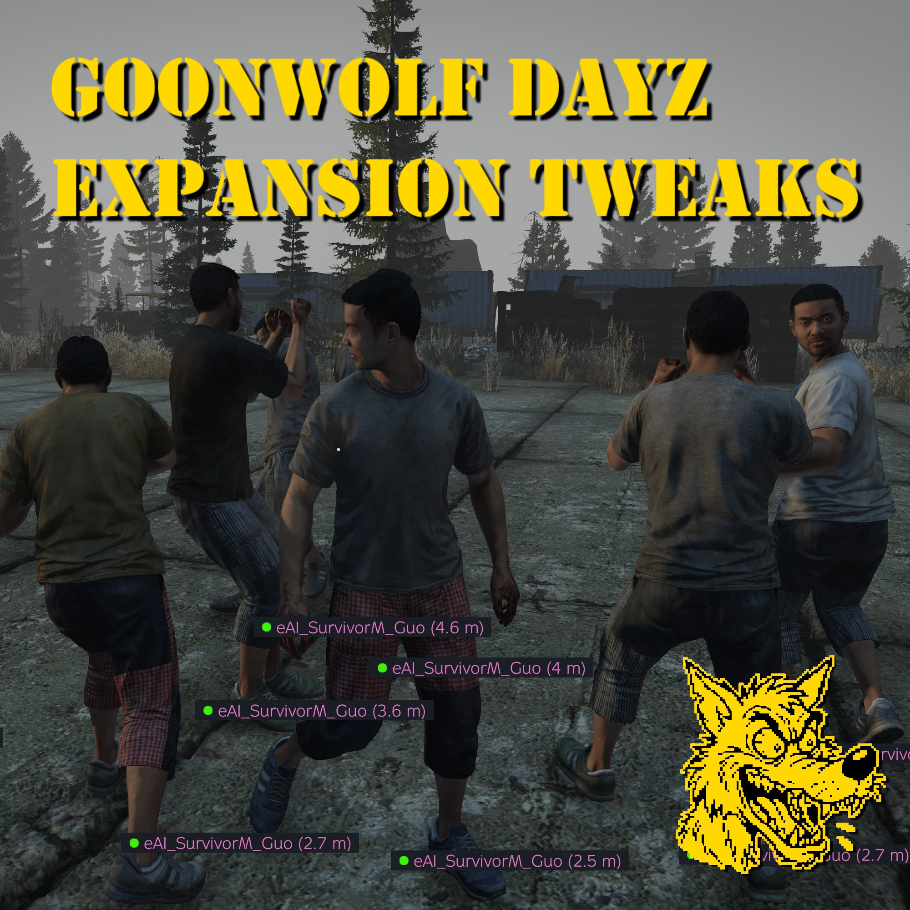
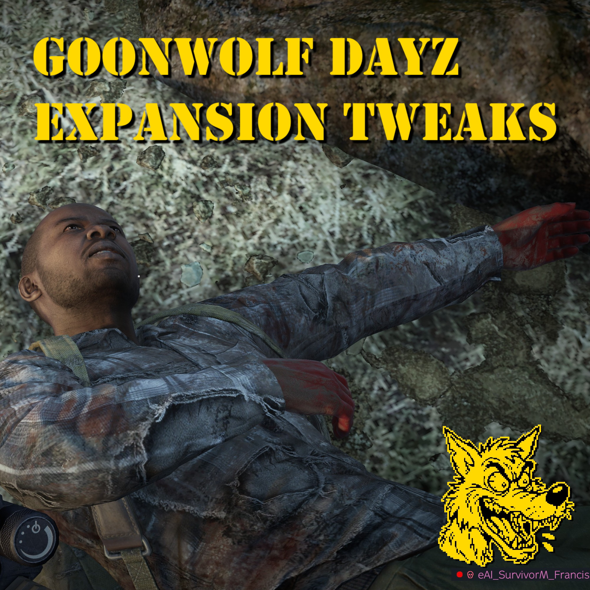
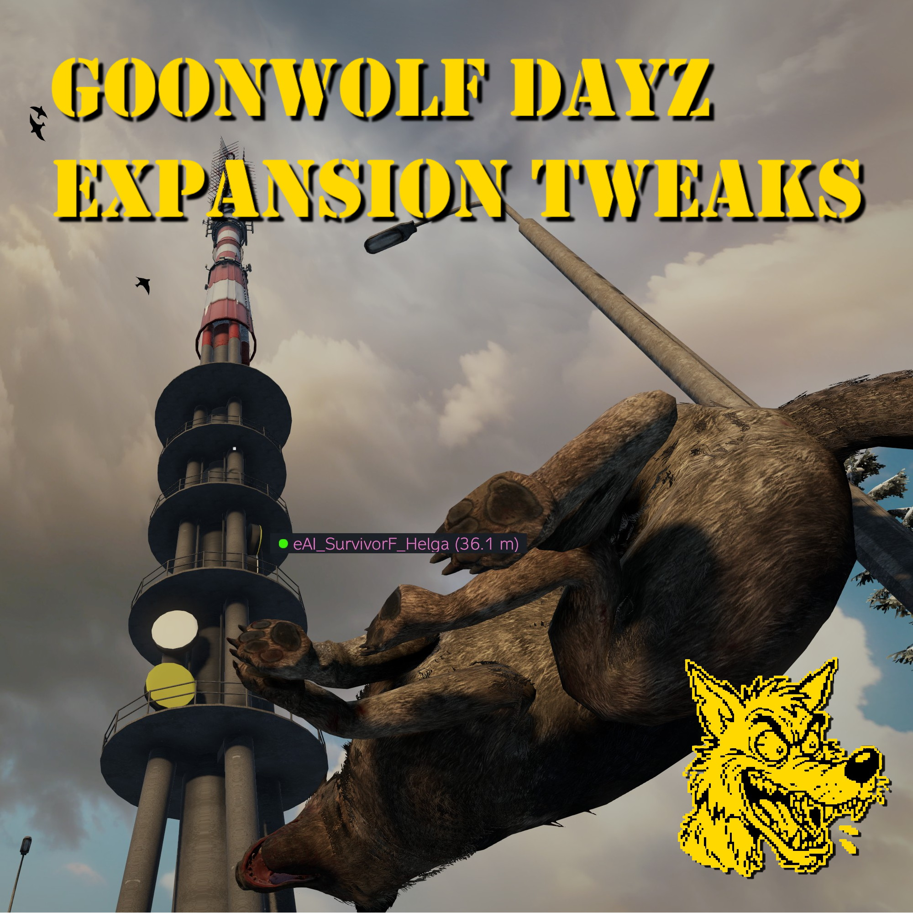

 

# GWExpansionTweaks
Source code for the 'Goonwolf DayZ Expansion Tweaks' mod for DayZ & DayZ Expansion.
Steam Workshop link: https://steamcommunity.com/sharedfiles/filedetails/?id=3843945921
Youtube demo: https://www.youtube.com/watch?v=cM7oYdlQYaM



-------
**Github Copilot summary:**
This extends DayZ Expansion mod with a bunch of tweaks for realism and randomisation. This includes:
* Random-looking AI: AI characters can have varied body sizes, beards, and bloodied hands.
* More combat targets: Server admins can force additional creature or animal types to be targeted by AI.
* Longer or shorter Expansion missions: Mission timers are randomly adjusted within limits set by the server.
* Custom-readable book items: The Expansion book can display customizable name, description, and error text.
* Radio chat notifications: Certain chat messages may trigger notifications when the player has a permitted radio or communication device.
* Location alerts: GPS-style location announcements require supported GPS items.
* Radio quest broadcasts: Expansion quests can become available on particular radio frequencies and at particular times of day.
* Quest rewards: Radio quests can drop flare rewards near the player.
* House interiors: Expansion house interiors can be enabled or controlled by server settings.
* Server-controlled settings: The server owner configures all of these features in a JSON file, and players receive the server’s settings automatically.

# Longer technical summary (extremely AI generated!)
A DayZ Expansion companion mod. Radios and GPS become the way you hear the world, quests can come in over the airwaves, AI look and fight less uniformly, and a few Expansion systems get lighter or more immersive defaults. Everything is toggled from one server JSON.

---

## What players notice

| Area | In short |
|------|----------|
| **Field Manual** | Expansion’s book menu only opens if you are carrying an approved book-style item (default: `ExpBookItem`). |
| **Notifications** | Most Expansion toasts need an approved radio-like device (and a battery in the slot if the item has one). Quest status still gets through. |
| **Global / team chat** | Optional: same radio requirement to send or receive on Expansion global/team channels. Proximity and admin stay open. |
| **Location popups** | City/area name toasts only show if you have an approved GPS item. |
| **Quest radio** | Power on or retune an allowed radio (handheld, base, or big panel) on a live frequency and in-game hour to open a quest board. Completing radio-giver quests can drop rewards nearby with a flare and red smoke. |
| **Building interiors** | About one third of Expansion’s decorative interior clutter is randomly skipped. Furniture that collides stays. |
| **AI** | Survivors can spawn with varied heights, with beards and/or bloody hands, and different for males and females. When injured or knocked uncon, they sometimes run for the hills, and can treat additional animals/creatures as threats. Quest NPCs and traders are not scaled or dressed up. |
| **Airdrops / missions** | Expansion mission start gaps are jittered so events feel less metronomic. |

A reference copy of the default config lives at the mod root as [`GwExpansionTweaks.json`](https://github.com/goonwolf666/GWExpansionTweaks/blob/main/GwExpansionTweaks/GwExpansionTweaks.json). The live file the server uses is:

```text
$profile:\Goonwolf\GwExpansionTweaks.json
```

On first run the server writes defaults there. Clients never read that file; they receive the live config over RPC when they join.

---

## Features (player + technical)

### Field Manual (`ExpansionBookItem_*`)

**Player:** Pressing Expansion’s book key only works while you carry a type from `ExpansionBookItem_AllowedItemTypes`. The item’s name and description come from the JSON; the description can show the bound key, or “too damaged” / “can’t read” text.

**Technical:**
- Gate: `MissionGameplay.OnBookTogglePressed` — if disabled or the allowed list is empty, Expansion’s normal book behaviour runs unchanged.
- Match: inventory scan via `FindLocalPlayerItem` (case-insensitive substring; ruined items ignored; battery slots must be filled when present).
- `ExpBookItem.NameOverride` / `DescriptionOverride` return `false` when the feature is off so `config.cpp` `displayName` / `descriptionShort` apply.
- Book settings are read with a null-safe `GetBook(false)` before `IsLoaded()` / `EnableBookMenu`.

### Radio notifications & chat (`ExpansionRadioNotifications_*`)

**Player:** Without an approved device, most Expansion notifications are suppressed. Matching “special” keywords plays a harsher radio stinger; bypass keywords keep Expansion’s normal look and sound. Global/team chat can be locked behind the same device list.

**How notification text is assessed** (`ExpansionNotificationView.ShowNotification`):
1. Title and detail are concatenated, then lower-cased/trimmed once (`Normalize`).
2. If the feature is off, or the allowed-item list is empty → no gate (normal Expansion toast).
3. If the combined text contains `"quest"` → **always pass** (no radio required, normal Expansion sound).
4. Else if any `BypassKeywords` substring matches → show with normal Expansion sound.
5. Else require a matching inventory item; if missing → decline the toast entirely.
6. Else play radio static; if any `SpecialKeywords` substring matches → special sound variant.

**Quest text that would not contain “quest”:** server-side `ExpansionQuest.SendNotification` (and the radio reward toast) prepends `"QUEST: "` when radio notifications are enabled and the raw title+text still lack `"quest"`, so those toasts still pass step 3.

**Chat gate** (`BlocksGlobalChat`):
- Needs `ExpansionRadioNotifications_Enabled`, `RequiredForGlobalChat`, and a non-empty allowed list.
- Server: `ExpansionGlobalChatModule.CanSendInChannel` for global/team.
- Client: channel switch / show-chat / incoming global-team messages forced to proximity when blocked.

### Location popups (`ExpansionLocationNotifications_*`)

**Player:** Expansion city/area banners only appear if you have a GPS from the list.

**Technical:** `ExpansionLocatorUI.OnShowCityClient` — if disabled, or the GPS list is empty, always calls `super`. Otherwise requires `FindLocalPlayerItem` on `GpsRequiredItems`.

### Quest radio (`ExpansionQuestsRadio_*`)

**Player:** On an allowed radio type, at a configured frequency (±0.01), during active hours (`HourActiveStart`/`End`; both `0` = always), power-on or frequency change opens the quest menu for that channel’s `QuestGiverID` (`-1` / blank = all Expansion-eligible quests). Radio menus play custom chatter static. With `FlareRewards`, turning in a quest whose giver is a configured radio channel drops loot on open dry land (35 → 70 → 105 m search), then a roadflare (~100 m up) and red smoke (~90 m up) with a short physics window, plus a toast.

**Technical:**
- Open path: `TransmitterBase` / `Land_Radio_PanelBig` / `ActionTurnOnTransmitterOnGround` → `RadioQuestBoardHelper.TryOpenQuestMenu` → RPC `RPC_RequestOpenQuestMenu`.
- Menu filtering: `QuestDisplayConditions` — radio context accepts giver **or** turn-in IDs; non-radio NPC IDs fall through to Expansion unchanged.
- `IsRadioMenuContext` is false when the feature is off (real NPCs matching a channel ID are not treated as radio boards).
- Panel tune/static sounds only when the feature is enabled.
- Flare rewards skip to normal Expansion spawning if disabled, player swimming/in vehicle, or no valid drop site.
- Quest menu static: `ExpansionQuestMenu` when `IsRadioMenuContext`.

### House interiors (`ExpansionHouseInteriors_Enabled`)

**Player:** Buildings feel a bit less stuffed with Expansion clutter.

**Technical:** `BuildingBase.SpawnInteriorObject` — for types Expansion has cached as **non-colliding**, ~33.4% chance (`RandomFloatInclusive(0,1) >= 0.666`) to skip spawn. Colliding furniture is untouched. Unguarded file; needs main Expansion scripts loaded.

### AI tweaks (`ExpansionTweaksForAI_*`)

**Player:** Hostile AI height varies; many get facial hair / bloody hands; some break and flee when critically hurt; listed creature class substrings (dogs, horses, bandit AI, etc.) are hunted as threats.

**Technical:**
- **Skip NPCs:** anything `IsInherited(eAINPCBase)` (quest NPCs, traders, P2P traders) skips scale and spawn visuals.
- **Scale:** rolled in `EOnInit` (average of two uniform samples between gender min/max). Gender min **or** max `<= 0` disables scale for that gender. Values within 5% of `1.0` stay `1.0` (no post-frame work). Otherwise `POSTFRAME` re-applies `SetScale` only while a **live player with identity** is within 500 m (checked every 10 s).
- **Beard / bloody hands:** `GwET_ApplyVisuals` after 3 s — independent rolls `RandomFloatInclusive(0,1) <= chance`. Beard only on males (states 1–3). Chance `0` skips that roll. Registers AI lifespan materials on both sides so clients see bloody hands.
- **Cowardice:** triggers from heavy injury, waking from uncon, or finishing a self-bandage (also forces bloody hands on bandage exit). Roll only if AI tweaks on, chance `> 0`, not already fleeing, player within 500 m, and at most 10 s since last evaluation. Cap of 30 concurrent cowards. Flee ~1000 m, passive, then restore as roaming Raiders faction.
- **Extra targets:** `AnimalBase` / `ZombieBase` `Expansion_IsDanger` via `IsForcedAiTarget`; `eAITargetInformation.GetCustomCreatureTargetInformation` installs `eAIForcedCreatureTargetInformation` when the entity type substring-matches `AdditionalTargetEntities` (threat falls off with distance out to 500 m).

### Mission timing (`RandomizeExpansionMissionTimes_*`)

**Player:** Airdrops and Expansion missions don’t fire on a rigid metronome.

**Technical:** `ExpansionMissionModule.RemoveMission` / `StartNewMissionsInternal` re-queue with `RandomizeDelayMs` (base × random between min/max multipliers). Either multiplier `<= 0` forces the feature off in `Validate()`. When disabled, Expansion’s own timing is preserved.

### Session logging (`ExpansionTweaksSessionLogging`)

**Technical:** When on, `GwExpansionTweaksUtils.GwLog` prints decision points (radio open/reject, drop sites + distance, scale on/off, clutter skip counts, etc.). Off by default; leave off in production.

---

## Shared matching rules

Used everywhere items or types are compared:

| Helper | Behaviour |
|--------|-----------|
| `Normalize` | Trim + lower-case copy. |
| `IsStringInListSub` | Haystack contains needle after normalize (substring, not exact class only). |
| `FindItemInInventory` | PREORDER inventory walk; skip ruined; type must match list; if any attachment slot name contains `"battery"`, that slot must have an attachment (no charge check). Items with no slots skip the battery test. Empty-battery matches fail silently. |
| `IsPlayerWithinRange` | Horizontal distance only; requires `IsAlive()` and `GetIdentity()` (no AI / dummy Persons). |

Empty **allowed-item** lists turn the related feature off (book, radio notifications/chat, GPS), same idea as the feature boolean being false.

---

## Config sync & versioning

- Server loads/creates `$profile:\Goonwolf\GwExpansionTweaks.json` on `MissionServer.OnInit`.
- `InvokeOnConnect` sends the whole `GwExpansionTweaksConfig` via CF RPC `RPC_Receive_GwExpansionTweaksConfig`.
- Client applies with `SetSyncedConfig` (validate + logging flag).
- `CONFIG_VERSION` mismatch → archive `*.old`, rewrite at current version (missing keys keep defaults from `SetDefaultValues` / `Validate`).
- Current schema version: **1**.

---

## Dependencies & modules

**Required (load order):** `DZ_Data`, `DZ_Scripts`, `DZ_Sounds_Effects`, `DF_Scripts` (Dabs), `DayZExpansion_Core_Scripts`, `DayZExpansion_Book_Scripts`, plus main Expansion scripts for interiors.

**Optional Expansion packs** (commented in `requiredAddons`; compiled only when their defines exist): Quests, AI, Chat, Missions, Navigation.

Preprocessor gates in code: `EXPANSIONMODAI`, `EXPANSIONMODBOOK`, `EXPANSIONMODQUESTS`, `EXPANSIONMODMISSIONS`, `EXPANSIONMODCHAT`, `EXPANSIONMODNAVIGATION`, `EXPANSIONUI`, `SERVER` / `#ifndef SERVER`, optional `MadBomberAI`.

---

## Layout

| Path | Role |
|------|------|
| `3_Game/` | Config singleton, utils |
| `4_World/` | AI, targets, book item, houses, missions, radio notifications, quest radio |
| `5_Mission/` | Book/chat gates, GPS locator, quest menu sounds, config sync |
| `Data/` | Book texture, logo, radio chatter `.ogg` samples |
| `config.cpp` | Patches, mods, `ExpBookItem`, radio volume overrides, `QuestRadioStatic_SoundSet` |
| `GwExpansionTweaks.json` | Default config reference (not loaded from the PBO) |

---

## Conventions for changes

- Call `GetGwTweaksConfig().*` directly (no local config aliases).
- Prefer `IsStringInListSub` / `FindItemInInventory` for type and item gates.
- Keep `super` unless the feature is explicitly disabled.
- Client sounds only via `g_Game.IsClient()` or `#ifndef SERVER` (`PlayAutodestroySound`).
- Log sparingly at decisions and key spawn/dispose points, behind `IsLogging()`.
- Do not remove functions without grepping the whole tree for references.
